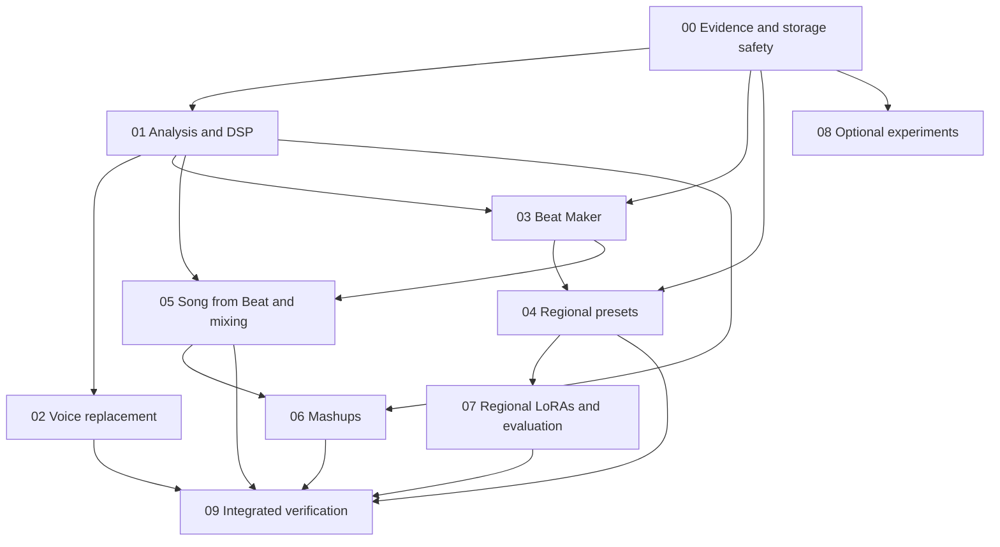

# Full Music Features Implementation Master Plan

> **For agentic workers:** Use superpowers:executing-plans for the selected phase. Focused subagents may own independent files under AGENTS.md; reconcile shared contracts before parallel edits. Checkboxes represent future work, not completed features.

**Goal:** Implement the full music feature report as recoverable local workflows: improved voice replacement, editable beats and regional presets, beat-conditioned songs, beat/song mixing, musical mashups and evaluated regional adapters.

**Architecture:** Extend the existing Vue/FastAPI/SQLite application, library, module setup, owned subprocesses, source provenance, training workspaces and durable generation queue. Add narrowly scoped analysis and rendering capabilities shared by the workflows. Keep CPU rendering, model work and human evaluation distinct; no new hosted service or general-purpose queue framework.

**Tech Stack:** Vue 3, Pinia, existing Tailwind/design system, generated strict TypeScript contracts, FastAPI/Pydantic, SQLite, NumPy, FFmpeg, existing isolated ACE-Step/Stable Audio/Seed-VC/RVC paths, reviewed optional analysis/stretch/sample dependencies.

---

## 1. Status and how to use these documents

Prepared **17 October 2026, Atlantic/Canary** against checkout `4609467881dc90af4c232b6eb67b6a1db7747782`. Source: [OpenFabric music feature report v1.0](../../../OpenFabric-Music-Features-Report-v1.0.pdf), all 34 pages. The report inspected an older commit, `d4f4a17`; its repository gap claims are not all current.

**This deliverable is a plan.** No application feature, test result, GPU benchmark, dataset clearance, model installation or musician approval is implied. Code snippets and new APIs in the phase documents are explicitly proposed implementations; existing integration anchors were inspected. Re-read moving code and primary dependency sources when executing.

**Execution started:** follow the [implementation progress and verification record](2026-10-17-music-execution.md). The phase checklists remain the full completion criteria; partial implementation does not mark the roadmap complete.

Start with the numbered phase table, then follow one phase's ordered tasks. Each phase includes exact existing/new file responsibilities, proposed contracts, validation, storage/ownership, error/recovery behavior, meaningful regression cases, interface work and exit criteria. New-file maps identify responsibilities; reuse an existing unit rather than creating a redundant abstraction if it already fits.

Do not implement all candidate models in the catalog. Required workflow capabilities and optional experiments have separate completion criteria. No code commits or pushes are part of this planning request.

## 2. Delivery phases and detailed plans

| Phase | Detailed plan | User-visible result | Prerequisites |
| --- | --- | --- | --- |
| 00 | [Foundation, evidence and disk safety](2026-10-17-music-00-foundation-licenses.md) | Clear installed/restricted states, scoped evidence, safe destinations and space forecasts | Baseline/copy/restore checks |
| 01 | [Shared audio analysis and DSP](2026-10-17-music-01-analysis-dsp.md) | Inspectable beats/key/sections/loudness; reusable bounded alignment/stretch/mix | 00, reviewed optional runtime |
| 02 | [Voice replacement v2](2026-10-17-music-02-voice-replacement.md) | Convert, prepared and hybrid modes; fit/preview/remix; RVC choice | 00/01, registered compatible voices |
| 03 | [Beat Maker](2026-10-17-music-03-beat-maker.md) | Saved editable sequencer, variation, exact preview, stems/MIDI/JSON and editor handoff | 00, shared source/DSP boundaries from 01 |
| 04 | [Regional instrument packs and 24 presets](2026-10-17-music-04-regional-presets.md) | Regional preset browser, tuning/rhythm/articulation rules and honest availability/review | 00/03, actual sample rights/assets; 01 diagnostics |
| 05 | [Song from Beat and beat/song mixing](2026-10-17-music-05-song-from-beat.md) | ACE Complete/Lego queue, optional verified Stable conditioning, layer/replace drums | 00/01/03; native task/base-model proof |
| 06 | [Mashups](2026-10-17-music-06-mashups.md) | Explained A/B candidates, ordered section plan, musical transforms and editable project | 00/01; source/project/render seams from 03/05 |
| 07 | [Regional LoRA data, training and evaluation](2026-10-17-music-07-regional-lora-evaluation.md) | Rights-reviewed datasets, separate adapters, held-out base comparison/model cards | Existing trainers, 00/04 data and review |
| 08 | [Optional technology decision backlog](2026-10-17-music-08-optional-technology.md) | Explicit experiments for live jam, symbolic AI, alternative analysis/voices/renderers | Demonstrated gap, evidence and bounded benchmark |
| 09 | [Verification, upgrade and rollout](2026-10-17-music-09-verification-rollout.md) | Recorded behavioral, platform, musical and recovery evidence | Runs throughout; integration/release gates at end |

The sequence follows the report's foundation/voice → beat/regional → song/mixing → mashup → adapter progression, with smaller explicit phases. It does not quietly drop any of those workflows.

### Dependency graph

The graph is implementation dependency, not a promise to postpone all testing until phase 09. Each phase runs its applicable checks before integration.

### Work that can start in parallel

- Source/terms/sample inventory, musician contact and recording requirements from 04/07 can start with 00. They may take longer than the software and must not be fabricated to make a milestone look complete.
- ACE base task and Stable conditioning capability probes from 05 should occur early after safe setup/evidence, before building a wizard that might advertise an unsupported pinned Mac path.
- After shared types and ownership boundaries are agreed, pure beat compiler/UI tasks and voice UI tasks can proceed with exclusive file ownership. Changes to main startup, schemas, common sources and queue admission stay coordinated.
- Optional live-jam/new-engine experiments do not block required workflows and do not get installed automatically.

## 3. Full workflow inventory

### Voice replacement

- [ ] Convert the original separated singer with a selected compatible Seed-VC or registered RVC voice.
- [ ] Accept a prepared vocal from upload/library without requiring an unused trained voice.
- [ ] Hybrid: align the prepared performance, then convert it to the selected voice.
- [ ] Choose separation quality; preserve backing and original; expose optional supported cleanup honestly.
- [ ] Fit with bounded phrase alignment, inspect low-confidence phrases, edit anchors and pitch, audition A/B.
- [ ] Match vocal loudness; offer bounded tonal/space/mix processing; measure final true peak.
- [ ] Remix retained vocals/backing without rerunning conversion; retain each completed output and source lineage.
- [ ] Preserve the stricter existing artist-production human-guide, authorization and release gates. General prepared audio cannot acquire 'clean master' status through this new UI.

### Beat creation and regional presets

- [ ] 8–16 lanes, 1–4 bars per pattern, four patterns, pattern chain/sections and saved revisions.
- [ ] Required 4/4 16/32/12/24-step grids plus real compound/asymmetric meter support.
- [ ] Hit velocity/probability/offset/ratchets/gate; gain/pan/mute/solo; global/per-lane supported swing.
- [ ] Generate, variation, humanise, fill, locked parts and deterministic seed.
- [ ] Scale/cents tuning and supported instrument articulations, not oscillator instruments renamed as samples.
- [ ] Preview the exact backend-rendered artifact; export mix, per-lane stems, MIDI with declared tuning limits and exact authoring JSON.
- [ ] Open rendered stems in the existing editor with links back to the saved beat revision.
- [ ] Regional browser, Traditional/Fusion/Modern pop categories, all 24 definitions, sample pack availability, source-specific tuning, 15 initial rhythm targets and musician review status.

### Beat/song workflows

- [ ] Layer a beat over a song or replace separated drums; align its grid and preserve originals.
- [ ] Re-render pitched beat parts for the target key instead of shifting the whole finished beat when symbolic source exists.
- [ ] Offer bass/kick leadership, bounded sidechain/EQ and measured loudness; save an editable project.
- [ ] Turn a saved beat into a queued ACE Complete/Lego job with tracks, style, lyrics, language and variations.
- [ ] Install/select compatible base weights deliberately; retain current Turbo/SFT selections and truthful capability guards.
- [ ] Keep Cover/Remix labeled as rewriting; no 'keep beat unchanged' promise without output evidence.
- [ ] Add Stable audio-to-audio/inpainting/continuation only for mode/variant paths actually proven in the pinned MLX runtime.

### Mashups

- [ ] A-vocals/B-backing, B-vocals/A-backing and custom selected stems.
- [ ] Explain tempo/key/section/energy fit and uncertainty, rather than showing an unexplained quality score.
- [ ] Preserve vocal order while choosing/looping/trimming accompaniment sections.
- [ ] Revisioned plan with source-frame/target-tick placements, locks, manual corrections and previews.
- [ ] Safe pitch/time transforms, downbeat placement, fades/filter transitions and optional verified generated bridges.
- [ ] Bounded EQ/ducking/loudness, retained dry stems, saved mix and one editable lane per selected stem.

### Regional adapters and optional experiments

- [ ] Evidence-backed recordings/captions with leak-resistant held-out splits.
- [ ] Separate tradition/base-model adapters through existing ACE/Stable trainers and exact compatibility metadata.
- [ ] Rank/budget experiments justified by measured comparisons; no automatic expensive sweep.
- [ ] Base-versus-adapter listening and objective diagnostics, dataset/model cards and safe export.
- [ ] Catalog decisions and selected experiments for symbolic AI, alternative analysis/transcription, extra conversion/renderers, prepared singing synthesis and Magenta RealTime 2.

## 4. Existing capabilities to preserve and reuse

| Verified current capability | Evidence | Design consequence |
| --- | --- | --- |
| LUFS/LRA/true-peak measurement and normalization | `backend/app/audio_quality.py`, `audio_quality_contracts.py` | Do not add pyloudnorm as a parallel default |
| Mixer EQ/compression/filter/limiter | `frontend/src/audio/mixerEngine.ts` | Extend only missing automation/sidechain/render behavior |
| Uploaded voice replacement, originals, jobs | `backend/app/voice_replacement.py`, `voice_build.py` | Preserve old request/results and job behavior during v2 |
| Strict prepared human-guide render | `backend/app/production_render.py`, `artist_production.py` | Preserve consent/range/source gates; no policy bypass |
| Optional RVC invocation | `backend/app/optional_engines.py` | Not yet an interchangeable registered replacement voice; integrate safely |
| Editor/audio lanes/MIDI/projects | `frontend/src/audio/timelineTypes.ts`, `api/editorValidation.ts`, `backend/app/api/routes_projects.py` | Reuse project playback/storage; add one tested builder seam for new workflows |
| Current immutable audio versions | `backend/app/audio_version_contracts.py`, `audio_version_store.py` | Kinds are original/voice; do not invent new kinds without migration |
| Generation queue and model admission | `backend/app/music_queue*.py`, `resource_admission.py`, `gpu_lease.py` | Extend source-conditioned requests; not a generic DSP scheduler |
| ACE task controls | `frontend/src/views/ace-step/GenerateForm.vue`, `backend/app/generation_contracts.py` | Task capability/readiness and queued source delivery still need proof |
| Dataset/caption/training/export workspaces | `backend/app/lora_datasets.py`, `training_captions.py`, `stable_lora.py`, `music_training.py`, `lora_export.py` | Extend current workflows and preserve recovery/name/destination safeguards |
| Evidence and export manifests | `backend/app/module_licenses.py`, `export_provenance.py`, `artist_production_contracts.py` | Preserve unknown/restricted states and private evidence redaction |

HeartMuLa was explicitly removed after the report's baseline. It remains retired, including optional experiments. Historic media and saved records are preserved.

## 5. Shared contract decisions before parallel implementation

The detailed definitions live in the owning phase; this section fixes cross-phase meanings:

1. **Sources:** Reuse plan 01's discriminated `MusicSourceRef` for existing immutable versions, controlled stems and production assets. IDs resolve server-side; no user paths/URLs/commands become a worker source. Retain/hash owner snapshots; a hard link does not by itself freeze mutable bytes.
2. **Identity:** Match existing 32-lowercase-hex IDs and 64-hex SHA-256 conventions. Bind derived work to source bytes, exact settings, runtime/model/sample identities and a saved revision.
3. **Units:** Public analysis/alignment uses finite `*_sec`; internal media math uses integer frames. Sequencing/arrangement uses PPQ 960 ticks and rational meter; BPM explicitly means quarter notes per minute.
4. **Analysis:** `AnalysisResult.id` identifies raw saved analysis; overrides have an independent revision. Unknown tempo/key/meter/vocal activity is a normal result, never a forced 4/4/C-major/default singer claim. Western major/minor classification does not fit every tuning.
5. **DSP:** Caller-owned typed `DspTransformRequest`/`DspMixRequest`, `WarpAnchor {source_sec,target_sec}` and `DuckSettings`; no independent general DSP job service. Duration ratio means target/source. Strict increasing rounded frames, bounded local stretch and memory/cell budgets are mandatory.
6. **Beat model:** One `BeatDocument`/pattern/compiler/renderer. Per-pattern meter `{numerator,denominator}` and `steps_per_quarter` derive bar/grid size; global swing is 0.50–0.75 where applicable. Instruments resolve by manifest ID; cents/bend/articulation support is typed and validated.
7. **Editor seam:** Plan 03's proposed `beat_projects.build_audio_project` returns `BuiltMusicProject {name,data,provenance}` using bounded generated models. Beat, mashup and song callers reuse this project builder; voice uses the shared media/publication boundaries where appropriate. Existing opaque historical projects stay readable; no wholesale project-schema migration.
8. **Publication:** Stage → verify bytes/metadata → register once with a durable workflow receipt → mark complete. Repeated requests/recovery cannot publish duplicates. A complete file whose catalog registration failed remains recoverable.
9. **Restrictions:** Code, weights, encoders, samples, source rights and human release review remain distinct. No permissive filename/license turns unknown inputs into legally approved outputs.
10. **Recovery:** Browser reconnect, verified stage reuse, interrupted retry and verified full-state model resume are different operations. No implicit checkpoint discovery on a fresh training run.

If source/type semantics change during implementation, update the owning phase and every downstream caller/test before proceeding. Do not hand-edit generated contracts to force agreement.

## 6. End-to-end safety and usability requirements

- Originals, datasets, labels, prior adapter runs and completed outputs remain intact after failure/cancel/retry.
- All background work has an owner, bounded resources, persisted identity and awaited descendant cleanup. Unproven cleanup blocks conflicting work and retains evidence.
- Network loss or closing the tab does not abandon completed work. Old UI responses cannot overwrite a newer session/revision.
- New job families use additive versioned migrations and explicit transitions; tests cover old records, concurrency, partial writes and publication recovery.
- Keep the configured data root and loopback binding. No incidental move of the live library or broad network exposure.
- Display source selection feedback, top-of-page active progress, elapsed time, meaningful measured ETA, expandable details and click-open parameter help.
- Folder selection previews a new named destination and refuses existing directories. No recursive deletion of caller-selected folders.
- Space forecasts include decoded audio, stems, transforms, temporary copies, model downloads/conversions and retained artifacts. Disk-full must not turn source cleanup into collateral damage.
- Use existing components, translations, keyboard/focus patterns and non-color-only states. Arranging and alignment cannot depend solely on mouse dragging.
- Every substantial implementation step has a relevant regression, contracts/type ripple work and appropriate actual verification.

## 7. Quality and external-evidence gates

Separate four completion levels in status/docs:

| Level | What must exist | What it does not prove |
| --- | --- | --- |
| Implemented | Typed behavior, persistence, errors, UI and meaningful tests | Native model compatibility or sound quality |
| Platform verified | Recorded real dependency/model flow on named hardware/runtime | Other platforms, long-run budgets or musical quality |
| Musically evaluated | Held-out annotated/listening results with settings and failures | Universal quality, identity or rights clearance |
| Approved for a distribution/release scope | Actual scoped rights/review and release evidence | Permission for other recordings/models/uses |

The PDF proposes voice onset accuracy, ±1 LU loudness matching, −1 dBTP, mashup ±20 ms downbeats, beat ≤1 ms grid timing, microtuning ±10 cents, instant-preview latency, beat retention and listener preference/recognition targets. Preserve these as **evaluation targets**, not completed facts or guarantees. Plan 09 supplies the protocol; plans 02/04/06/07 own their feature-specific outcomes.

Actual sample availability, per-file redistribution/training scope, commissioned recordings, practising-musician review, exact native platform support and subjective quality cannot be completed by writing UI code. Mark them as concrete prerequisites, not placeholder success states.

## 8. Report coverage and disposition map

| Report section | Coverage | Correction/disposition |
| --- | --- | --- |
| 1 Current repository/gaps | Master §4 and each phase's verified anchors | Older snapshot; preserve current queue/training/HeartMuLa removal |
| 2 Shared architecture/analysis/policy | 00/01 and master §5 | Reuse existing loudness/evidence/ownership; no redundant service framework |
| 3 Voice replacement A/B/C, fitting/mixing/wizard/API | 02 with shared 01 | Integrated RVC requires a model registry/lifecycle, not only a selector |
| 4 Mashup analysis/scoring/mapping/transform/DAW | 06 with 01/05 | Ordered mapping instead of unconstrained Hungarian assignment |
| 5.1–5.4 Sequencer/generators/instruments | 03/04, optional 08 | One backend render artifact for preview/export identity |
| 5.5–5.8 Song from Beat, mix/song UI/API | 05 | Base setup, source ownership and actual queue dispatch must all change |
| 5.9 Acceptance | 03/05/09 | Measured targets, not assumed unchanged beat/model timing |
| 6.1–6.3 Cultural cues/scales/rhythms | 04 | Source-specific tuning/review, compound/asymmetric meter |
| 6.4 All 24 presets | 04 R06 | Explicit inventory and per-preset assets/review states |
| 6.5–6.6 Assets/three-layer generation | 04/03/05 | Actual sound packs plus deterministic core and optional AI pass |
| 6.7 Regional LoRA | 07 | Real data/evidence and held-out evaluations; HeartMuLa excluded |
| 6.8–6.9 Browser/evaluation | 04/09 | Recognizability and authenticity require external listening review |
| 7 Candidate catalog | 08; selected tools in 01/02/05/07 | Alternatives are evaluated only for a demonstrated need |
| 8 Evaluation | 09 and feature-specific criteria | Keep benchmark identities, data splits, failures and uncertainty |
| 9 License fields/policy | 00/07/08 | No automatic legal-clearance Boolean; exact dependencies matter |
| 10 Risks | Phase failure cases plus master §6/7/9 | Storage, task compatibility, data rights and cultural review included |
| 11 Phased roadmap | Master §2 and all detailed plans | Finer phases, same full workflow scope; no fabricated dates |
| 12 Sources/unknowns | Each adoption task and 08 checklist | Revalidate pinned primary sources at execution, especially model/asset terms |

The report's old-clone synchronization path is not this workspace. Its proposed GitHub description fix needs a current metadata inspection and separately scoped external action; no assumption that it is still stale.

## 9. Risk register and decision rules

| Risk | Prevent/detect | Completion response |
| --- | --- | --- |
| Disk exhaustion/source overwrite | Forecast, exclusive staging, destination refusal, disk-full fault tests | Preserve inputs and previous results; retry publication/cleanup only owned partials |
| Incorrect/ambiguous beats/key | Manual overrides, unknown/confidence states, annotated fixtures | Ask for correction/audition, not a fabricated grid |
| Misaligned or over-stretched vocals | Phrase/cell budget, monotonic anchors, local ratio caps, preview | Refuse unsafe auto-fit; permit bounded manual correction |
| Native task absent in pinned runtime | Early source inspection and real short capability probes | Keep unavailable; report exact blocker and reviewed alternative |
| Excessive M4 resource use | Short cold/warm trials, memory/disk/step timing, admission | Limit duration/data/concurrency based on measurements |
| Sample/weight/source-rights uncertainty | Per-component evidence, scoped use/review, propagation | Exclude from restricted distribution route or label explicit research experiment |
| Cultural caricature/wrong tuning | Tradition-specific sources, instrument behavior and musician review | Revise/relabel, retain unreviewed status; never invent approval |
| Wrong training source/split/adapter | Immutable dataset/model revisions, duplicate/name checks, holdout grouping | Block mismatch, keep old runs, explicit fresh versus verified resume |
| Parallel plan/API drift | Owner-defined shared types, generator check and integrated diff review | Reconcile before editing dependent files |
| Feature/engine sprawl | Working deterministic baseline and experiment adoption gates | Decline candidates with no measured useful gain |

Do not turn uncertainty into repeated approval requests. During execution, resolve ordinary implementation choices through the repository/report and evidence. Ask only for a missing material product/data/security/compatibility decision or an explicitly required external authorization.

## 10. Implementation cadence and completion checklist

For each phase:

1. Re-read its actual callers, schemas, fixtures, dependency pins and touched entry points.
2. Confirm proposed types/bounds against upstream source and freeze shared semantics with dependent phases.
3. Write the smallest meaningful failing regression for the next behavior.
4. Implement the complete boundary change, including validation, storage, job ownership, generated contracts, UI and recovery affected by that behavior.
5. Run focused checks, inspect failures and fix root causes. Do not broaden test scope repeatedly without a reason.
6. Complete applicable repository checks, CPU/API integration and platform/audio evidence required for that phase's claim.
7. Review final diff, document actual results/limits and demonstrate the usable workflow.
8. When a commit/push is requested, use the requested branch or ask the target then; do not treat a planning checkbox as Git authorization.

Program completion requires:

- [ ] 00–07 required capabilities implemented and verified to the explicitly stated level; optional 08 experiments have recorded adoption/decline decisions rather than being silently half-integrated.
- [ ] Existing generation, paired YuE training, source/library preservation and retired-engine behavior still pass regressions.
- [ ] The report's full workflow inventory has a reachable usable UI, not an empty tab or schema-only implementation.
- [ ] All 24 presets have valid definitions and honest asset/review outcomes; claimed available/reviewed presets meet those requirements.
- [ ] Full applicable frontend/backend/contracts/strict typing/desktop checks pass with exact logs and skips recorded.
- [ ] Copied-library upgrade/interruption/rollback, browser recovery, cancellation, low disk and safe exports pass.
- [ ] Claimed Mac model modes have actual short-run evidence; long-run performance and other platforms remain qualified until separately measured.
- [ ] Musical/data/review targets are met or explicitly reported as not met; the release cannot claim an unmeasured result.
- [ ] Documentation and export manifests accurately reflect sources, installed components, model/sample restrictions and remaining unknowns.

## 11. Effort and scheduling

The PDF estimates roughly 9–11 developer-weeks for its phases 0–4 and additional data-dependent work for regional adapters. That is the report author's estimate, not a measured schedule for this checkout. Do not present it as a delivery commitment.

Re-estimate after three concrete checkpoints: analysis/native DSP proof, one complete sample-to-beat-to-editor flow, and real ACE/Stable conditioning proof. Record actual implementation time and resource costs by milestone. Source acquisition, permission review, commissioned sessions and listening-panel availability are external dependencies with their own schedule.

**Planning verification:** Check internal links, file anchors, shared type names, meter/time/pitch conventions, all 24 presets, report-section coverage, code-fence balance and unsafe/contradictory instructions before handing this plan over. Application tests and model runs belong to execution, not this document's completion claim.
